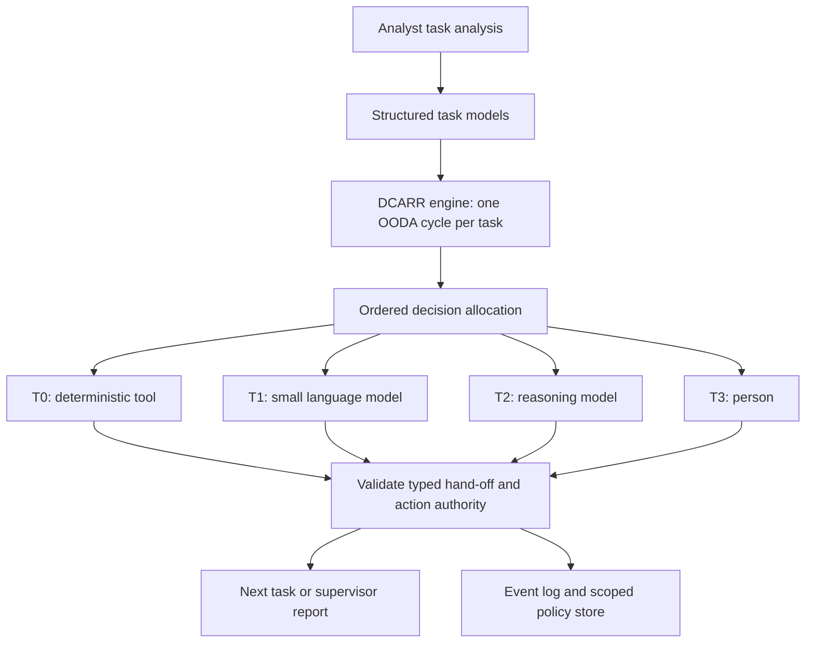
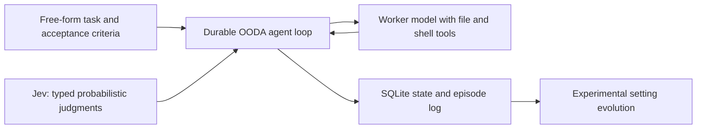
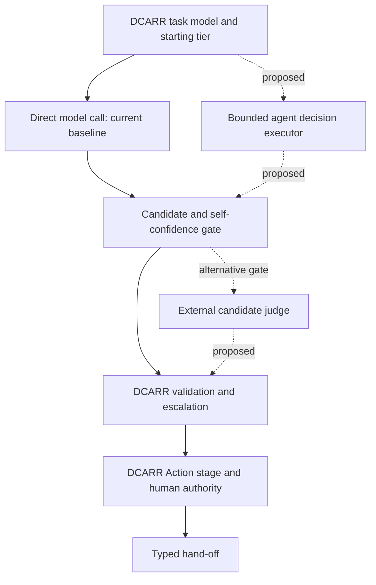

# Architecture and project boundaries

## DCARR runtime

DCARR's task analysis supplies structured task models. Each specifies Observe,
Orient, Decide, Act and a hand-off, plus the attributes used to allocate its
decision. The Python engine executes the hierarchy in plan order.

The starting tier is a design heuristic, not a measured guarantee of the
cheapest capable executor. Machine abstention, insufficient confidence, invalid
fields or an exceeded hand-off budget can escalate a decision. Complex-domain
model outputs are proposals for a person. Normative choices require a person
unless an explicitly scoped stored policy covers the declared situation.

Action permission is separate from who decided: an action can need approval or
allow a veto. A refused required action stops the plan. The engine validates
people's and stored-policy payloads as well as model outputs.

| Concern | Source |
|---|---|
| Task-model types | `src/dcarr_runtime/metamodel.py` |
| Ordered clauses and action levels | `src/dcarr_runtime/allocation.py` |
| Execution, escalation and authority | `src/dcarr_runtime/engine.py`, `boundary.py` |
| Typed fields, enums and size budgets | `src/dcarr_runtime/handoff.py` |
| Scoped policy matching | `src/dcarr_runtime/policy.py` |
| Model/tool/person adapters | `src/dcarr_runtime/executors.py` |
| Tanker task models, simulation and stand-ins | `scenarios/simpilot/` |

Source paths are relative to the repository root.

The small/reasoning-model tiers offer a System 1/System 2 analogy for economical
routine processing and more deliberate reasoning. They are not a measured model
of human cognition. The current engine raises the tier on abstention and reduces
other work through its starting allocation, bounded context and policy reuse;
it does not continuously optimize reasoning depth.

Information fusion is expressed through task-model hierarchy and the declared
content and fusion level of each hand-off. It specifies what subsequent tasks
and supervisors need to receive. The DCARR engine does not currently incorporate
the OODA harness's Jev evidence-fusion mechanism.

## Study harness

`study1/harness.py` builds the scenario with each comparison condition. It uses
DCARR's Python engine and adds study-specific forced decisions, scoring and a
scripted person. `study1/run.py` schedules collection; `backend.py` records raw
requests, responses, usage and attempts; `serving.py` captures launch/snapshot
provenance; `analyze.py` validates the evidence and computes the tables.

The study harness is the paper's evaluation infrastructure. It is distinct from
the separately named OODA harness. The study calls vLLM directly through an
OpenAI-compatible HTTP interface. It does not import the OODA TypeScript agent.

## Separate OODA harness

[ooda-harness](https://github.com/Rainierraoul/ooda-harness), maintained separately by the same author, is a different
agent application:

| Question | DCARR | OODA harness |
|---|---|---|
| Unit of work | A decision inside an analyst-specified task model | An agent run inside a requested task |
| How work is assigned | Explicit clauses, formal specifiability, cognitive control, domain and authority | Jev judgments and configured strategies guide a worker |
| Human authority | Task-level person tier, requests, action approval/veto and scoped policies | The agent's configured tool gate and acceptance criteria |
| Tools | Registered scenario sensors, algorithms and actuators | File and shell tools available to the worker |
| Recorded state | JSONL events and JSON policies; study request ledger | Durable SQLite tasks/documents and episode log |
| Adaptation | A person's explicitly scoped stored policy | Experimental mutation/evaluation of harness settings |
| Paper role | Method implementation and computational evaluation | None; a basis for the proposed follow-ups |

Shared OODA vocabulary is a conceptual relationship, not evidence of software
integration. `PiBackend` is an optional generic pi RPC adapter; it does not wire
the separately defined OODA loop or Jev into DCARR. It is not used by the frozen
study configuration.

This repository therefore contains the runtime, synthetic example and study.
ooda-harness remains a separate project. Its unrelated agent experiments and
evolution results must not be presented as evidence for DCARR.

## Proposed extensions

The [direction notes](directions/README.md) describe two independent changes to
the baseline. They are research plans, not executable features.

An inner agent must have read-only tools and declared sources; it returns a
decision or abstention. World-changing actions remain in DCARR's Action stage.
Declaring sources and tools broadens the current fixed-input contract and must
be specified as a method change in a future protocol. The external-judge direction
instead changes the gate on saved candidates and can be studied separately.
